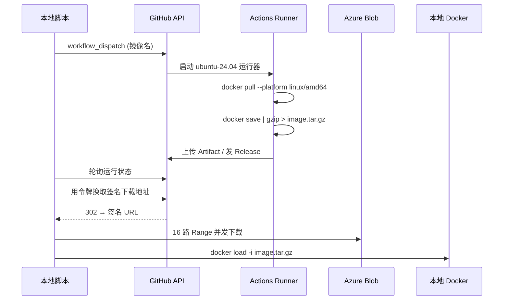

# Docker_images_Download

[](https://github.com/Fzzdjs/Docker_images_Download/releases)
[](LICENSE)
[](https://www.python.org/)
[](scripts/fetch_image.py)

**在国内网络下拉不动 Docker 镜像时，借 GitHub Actions 的海外运行器代拉，再导出成 tar.gz 下载回本地。**
不需要服务器、不需要镜像加速器、不依赖任何第三方镜像站，支持 `docker.io`、`ghcr.io`、
`quay.io`、`registry.k8s.io`、`mcr.microsoft.com` 等任意公开 registry。

[English](README_EN.md) · [排查手册](docs/troubleshooting.md) · [架构说明](docs/architecture.md)

---

## 解决什么问题

国内直连 Docker Hub 常见三种失败：DNS 被污染、TLS 握手被重置、单连接被限速到几十 KB/s。
镜像加速器能缓解 `docker.io`，但节点随时关停，且**完全不覆盖** `registry.k8s.io`、
`ghcr.io`、`quay.io` 这类 registry。

本项目把"拉取"这一步搬到 GitHub 的托管运行器上完成——那里到各大 registry 是通的——
只把**结果**（镜像 tar.gz）传回本地。整个链路没有任何需要自己维护的服务器。

## 工作原理



两个关键点：

1. **下载必须并发分片。** 产物落在 Azure Blob，国内单连接实测只有 30–80 KB/s，
   1 GB 镜像要 5–9 小时；16 路 Range 并发后聚合约 0.7–1.5 MB/s，同镜像 15–25 分钟。
2. **令牌不能跟随 302 跳转。** Blob 收到带 `Authorization` 的请求会返回
   `401 InvalidAuthenticationInfo`。脚本先用令牌换签名地址，再裸连下载。

## 快速开始

### 1. Fork 本仓库

脚本会向仓库触发 Actions，所以必须用**你有写权限**的仓库。点右上角 Fork 即可。

### 2. 准备一个令牌

任选一种，脚本按顺序自动查找：

```bash
gh auth login                     # 推荐：已登录的 GitHub CLI
export GITHUB_TOKEN=ghp_xxx       # 或环境变量（Windows: setx GITHUB_TOKEN ghp_xxx）
```

权限要求：

| 令牌类型 | 需要的权限 |
|---|---|
| 经典令牌 | `public_repo` + `workflow`（**`workflow` 必需**，否则无法触发 `workflow_dispatch`） |
| 细粒度令牌 | Contents = Read，Actions = **Read and write** |

创建地址：<https://github.com/settings/tokens>

### 3. 开始下载

```bash
git clone https://github.com/<你的账号>/Docker_images_Download.git
cd Docker_images_Download

python scripts/fetch_image.py nginx:alpine
```

脚本会自动识别当前 checkout 的 git remote，把工作流触发到**你自己的 fork** 上。
只有一个 Python 标准库依赖，3.8+ 开箱即用。

```
[14:02:11] 账号      : your-name
[14:02:11] 令牌来源  : GitHub CLI (gh auth token)
[14:02:11] 镜像      : nginx:alpine
[14:02:12] 中转仓库  : your-name/Docker_images_Download @ main  (git remote of this checkout)
[14:02:12] 触发工作流 ...
等待工作流 工作流运行中 / 00:46  执行中  (上限还剩 29:14)
下载产物 [████████████████████████████████] 100.0%  72.1 MB / 72.1 MB  1.05 MB/s  剩余 00:00
完成: 1 个镜像文件
  nginx_alpine-amd64.tar.gz                                72.10 MB
```

## 常用命令

```bash
# 输出到指定目录并直接导入本地 Docker
python scripts/fetch_image.py nginx:alpine --out ./images --load

# 一次拉多个镜像（空格分隔）
python scripts/fetch_image.py redis:7 postgres:16-alpine --out ./images

# k8s 组件镜像
python scripts/fetch_image.py registry.k8s.io/pause:3.10

# ARM64（树莓派 / ARM NAS / 鲲鹏）
python scripts/fetch_image.py alpine:latest --platform arm64

# 发到 Release，得到一个可直接分享的公开链接
python scripts/fetch_image.py my/app:v1 --mode release

# 只体检，不触发运行：令牌、仓库权限、Actions、工作流是否齐备
python scripts/fetch_image.py --check

# 机器可读结果，便于接到别的脚本里
python scripts/fetch_image.py nginx:alpine --json

# 日志重定向时关掉进度条
python scripts/fetch_image.py nginx:alpine --no-progress > fetch.log 2>&1
```

导入：

```bash
docker load -i nginx_alpine-amd64.tar.gz
```

## 参数

| 参数 | 默认 | 说明 |
|---|---|---|
| `images` | 必填 | 一个或多个镜像名 |
| `--platform` | `amd64` | `amd64` / `arm64` / `arm32` |
| `--mode` | `auto` | `auto` = Actions 产物；`release` = Release 附件 |
| `--repo` | 自动识别 | 中转仓库 `owner/name` |
| `--ref` | 当前分支 → `main` | 触发的分支 |
| `--out` | `.` | 保存目录 |
| `--load` | 关 | 下载后自动 `docker load` |
| `--timeout` | `1800` | 等待工作流的上限秒数 |
| `--retention-days` | `1` | 产物保留天数（1–90） |
| `--connections` | `16` | 下载分片并发数 |
| `--no-progress` | 关 | 关闭进度显示 |
| `--check` | 关 | 只检查配置 |
| `--json` | 关 | JSON 输出 |
| `--version` | — | 版本号 |

## 两种模式

| | `auto`（默认，Actions 产物） | `release`（Release 附件） |
|---|---|---|
| 适用 | 即取即用，私有 | 需要公开分享的固定链接 |
| 容量 | 受运行器磁盘限制（10–14 GB 实存） | **单附件 ≤ 2 GiB** |
| 下载认证 | 需要令牌 | 公开，凭链接即可 |
| 保留 | 默认 1 天 | 长期，同名覆盖 |

> 大于 2 GiB 的镜像请用 `auto`：Release 的 2 GiB 是 GitHub 硬限制，工作流会提前检查并报错。

## 作为 Agent 技能安装

仓库本身就是一个可加载的技能（`SKILL.md`），可安装到常见技能目录：

```bash
python scripts/install_skill.py --target workbuddy   # ~/.workbuddy/skills/Docker_images_Download
python scripts/install_skill.py --target claude      # ~/.claude/skills/Docker_images_Download
python scripts/install_skill.py --target custom --path ~/skills --force
```

安装副本没有 `.git`，安装器会写入 `.repo` 记录中转仓库；运行时也能用 `--repo` 覆盖。

## 性能参考

| 阶段 | 耗时（1 GB 镜像） |
|---|---|
| 运行器 pull + save + gzip | 3–5 分钟 |
| 产物下载（16 并发，国内家宽） | 12–20 分钟 |
| 解包 + `docker load` | 1–2 分钟 |

`--connections` 调到 32 通常没有收益：瓶颈已经是你自己的出口带宽。
如果长期高频使用，建议自建一台境外中转机并把 `RUNNER_LABELS` 指向它
（`self-hosted`），详见 [docs/architecture.md](docs/architecture.md)。

## 支持的 registry

只要是**公开**镜像，运行器就能拉：

| Registry | 示例 |
|---|---|
| Docker Hub | `nginx:alpine`、`library/postgres:16` |
| GitHub Container Registry | `ghcr.io/tencentcloud/octop:latest` |
| Kubernetes | `registry.k8s.io/pause:3.10` |
| Quay | `quay.io/prometheus/node-exporter:latest` |
| Microsoft | `mcr.microsoft.com/dotnet/runtime:8.0` |
| NVIDIA | `nvcr.io/nvidia/cuda:12.4.0-runtime-ubuntu22.04` |

私有镜像需在 fork 中配置 `secrets` 并改造工作流（`docker login`），默认不包含。

## 安全说明

- **令牌不落盘**：脚本只从 `--token`、环境变量、`gh auth token` 读取，不写任何配置文件。
- **令牌不外泄**：所有认证头都用 `add_unredirected_header`，302 到 Blob 时不携带。
- **产物是私有的**：`auto` 模式的 Artifact 只有仓库有权限的人能下载；
  只有 `release` 模式才会生成公开链接。
- **工作流只用官方 action**，并显式声明最小 `permissions`（产物模式 `contents: read`）。
- 仓库里没有任何密钥；`GITHUB_TOKEN` 由 Actions 运行时注入。

## 已知限制

| 限制 | 说明 |
|---|---|
| 需要 GitHub 账号 | 且令牌必须有 Actions 写权限 |
| 运行器磁盘 | 托管运行器约 14 GB，超大镜像（> 5 GB）可能放不下 |
| Release 2 GiB | GitHub 硬限制，大镜像用 `auto` |
| 单次 1–3 分钟 | 不适合"每分钟几十个镜像"的高频批量场景，那种场景请用自建 registry 缓存 |
| 公开镜像 | 私有 registry 需要自行注入凭据 |
| GitHub 服务条款 | 属于个人合理使用范围；不要拿它做公开镜像分发服务 |

## 故障排查

先跑一次体检：

```bash
python scripts/fetch_image.py --check
```

它会打印账号、仓库可见性、push 权限、Actions 是否启用、工作流是否齐备，并直接指出缺什么。

常见问题：

| 症状 | 处理 |
|---|---|
| `403 Resource not accessible by integration` | 令牌只读，或缺 `workflow` / Actions:write |
| `令牌对 xxx 没有写权限` | 没有 fork，或 `--repo` 指到了上游仓库 |
| 工作流卡在 `queued` | 免费账号并发有限，等同仓库其他运行结束 |
| 下载 403 中途失败 | 签名地址过期，脚本会自动换新地址重试；若持续失败重跑一次 |
| `产物已过期` | Artifact 超过保留期，重跑 |
| `api.github.com` 不通 | 换网络，或在能通的机器上下载后拷入 |

完整清单见 [docs/troubleshooting.md](docs/troubleshooting.md)。

## 与其他方案对比

| 方案 | 需要服务器 | 覆盖非 docker.io | 大镜像 | 长期稳定性 |
|---|---|---|---|---|
| 镜像加速器 `registry-mirrors` | 否 | ❌ | 一般 | 节点随时关停 |
| 第三方公共代理 | 否 | 部分 | 一般 | 波动大、内容不可验证 |
| **本项目（Actions 中转）** | **否** | **✅** | **好** | 依赖 GitHub，稳定 |
| 自建 Harbor proxy cache | 是 | ✅ | 好 | 需运维，但最可控 |
| 云厂商 CR 同步 | 否 | 视厂商 | 好 | 需云账号与配额 |

## 项目结构

```
Docker_images_Download/
├── scripts/
│   ├── fetch_image.py      # CLI 主流程：触发 → 等待 → 下载 → 可选导入
│   ├── gh_client.py        # GitHub API 客户端（含令牌解析与 302 处理）
│   ├── parallel_dl.py      # 多线程 Range 分片下载器
│   ├── progress.py         # 进度条 / 旋转指示器（TTY 自适应）
│   └── install_skill.py    # 安装为 agent 技能
├── .github/workflows/      # 6 个中转工作流（3 架构 × 产物/Release）
├── docs/
│   ├── architecture.md     # 设计取舍、自建运行器、容量规划
│   └── troubleshooting.md  # 错误码与定位方法
└── tests/                  # 零依赖单元测试
```

## 开发

```bash
python -m unittest discover -s tests -v
```

CI 在 Ubuntu 与 Windows 上跑 3.9 / 3.12 / 3.13 三档 Python，无第三方依赖。

## 贡献

见 [CONTRIBUTING.md](CONTRIBUTING.md)。欢迎提 issue 反馈 registry 兼容性与下载速度数据。

## 许可证

[MIT](LICENSE) © 2026 Fzzdjs
